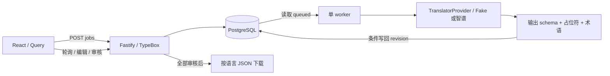

# 从零设计的翻译闭环

## 边界

浏览器负责输入、呈现和审核；API 负责运行时校验和 SQL 事务；worker 负责执行持久化任务；provider 只负责生成翻译；导出重新检查质量和审核状态。浏览器不持有模型密钥。

## 数据与状态

- `translation_jobs` 保存语言、术语、实验场景和聚合状态。
- `translation_results` 每个 `(job_id, source_key, language)` 一行。英语源文不可变，每项拥有 status、attempts、error_code、revision、human_edited、approved。
- `translation_attempts` 保存执行次数、结果、错误码和耗时；不保存 raw prompt / 凭据。
- `schema_migrations` 防止重复执行迁移。

结果状态为 `queued → running → succeeded/failed`；失败且未达到 3 次会重新入队。任务聚合与审核分开：任务成功不代表人工已审核，更不代表真实翻译准确。

API 创建任务只写 SQL，然后返回 HTTP 202。单 worker 会在每次执行前读取数据库，因此队列不依赖浏览器或内存。用户主动重试只重置未受保护的 failed 结果；已成功、人工修改或已审核的结果保持。

## 事务、并发和重启

一个 worker 长期持有 PostgreSQL session advisory lock；同库同 schema 的第二个 worker 被拒绝。进程死亡后连接关闭，锁由 PostgreSQL 释放。该锁使用单独连接，不能经 PgBouncer transaction pooling 使用。

所有修改遵循先锁 job、再锁 result 的顺序。worker 领取记录时递增 attempts 与 revision，提交模型输出时必须满足相同 revision、running、非人工修改、非审核。人工编辑递增 revision，过期模型输出写入 `discarded` 尝试记录。

worker 启动时会恢复 running 结果；未耗尽尝试次数的结果重新入队，已耗尽的记为 `WORKER_INTERRUPTED`。写回遇到临时数据库错误时，下一次空闲 tick 同样恢复遗留 running。数据库保存任务；崩溃后的模型调用可能被重复执行，因此不承诺 exactly-once 的供应商计费。

这不是 Redis / BullMQ 队列：无多节点 lease、优先级、延迟任务或全局速率限制。先验证单进程闭环，出现实际需求后再升级。

## 质量契约

provider 输入与输出分别由 TypeBox 检查。输出必须是严格的 `{ key, language, text }` 对象，不接受非字符串或额外字段；再检查 key、语言、占位符多重集合和术语。人工修改和导出也使用同一验证函数。

这些是机械约束。语义准确度、自然表达、文化差异、词形变化和 UI 字数仍需单独样例评审。Fake 可以测确定性错误路径，但不能测模型质量。

## API

| 方法  | 路径                          | 行为                                  |
| ----- | ----------------------------- | ------------------------------------- |
| POST  | `/api/jobs`                   | 校验输入、创建任务，202               |
| GET   | `/api/jobs`                   | 最近 50 个任务                        |
| GET   | `/api/jobs/:id`               | 聚合状态与计数                        |
| GET   | `/api/jobs/:id/items`         | 逐语言结果                            |
| PATCH | `/api/jobs/:id/items/:itemId` | 编辑/审核，版本冲突 409，质量拒绝 422 |
| POST  | `/api/jobs/:id/retry`         | 重试未保护的失败项                    |
| GET   | `/api/jobs/:id/export/:lang`  | 审核完成才下载，未就绪 409            |
| GET   | `/api/docs/json`              | 从实际路由生成 OpenAPI                |

## 前端状态

TanStack Query 区分任务列表、任务详情和结果列表。mutation 成功后 invalidate 对应缓存。任务和结果列表分别根据自身状态停止轮询，避免总状态先完成导致结果列表错过最后一次更新。编辑弹窗保留打开时的 revision，过期编辑返回 409，由用户刷新检查后再次编辑。

## 智谱 provider

用户已授权使用本机个人智谱 key。`ZhipuTranslator` 通过 Node 原生 fetch 调用智谱官方 HTTPS API，不新增 SDK 依赖。显式选择 provider 才启用真实请求，密钥缺失则启动失败；默认仍为 Fake。JSON 输出、按模型配置思考参数和 AbortSignal 与现有质量检查、SQL 条件写回保护共同工作，适配器不写数据库。`/api/health` 返回运行实例的 provider 与模型，不返回凭据，也不代表供应商永远可用。

真实调用超时 60 秒；429、5xx、网络错误及质量错误可重试，最多 3 次，自动重试退避 2 秒、4 秒。401/403、402 和其他请求错误只记一次，不自动重复付费请求。5.3 系列必须开启思考，翻译使用 `reasoning_effort=low` 和 8192 输出 token 上限；4.7 系列关闭思考。只发送源文涉及的术语；`finish_reason=length` 直接记为 `OUTPUT_TRUNCATED`，不原样重复请求。错误日志只保留内部错误码，供应商响应原文和密钥不写入日志。供应商调用成功小样本与系统可靠性验收分开记录，完整语义质量评测尚未完成。

## 已知限制

- 本地单用户，无身份、授权和多租户边界，不用于公网部署。
- 单 worker、key-level 有界并发（默认 2，范围 1–4）；每个 key 一次请求最多 50 languages，结果逐语言持久化；无队列配额、取消接口、SSE 或持续模型成本统计。
- 重试周期内最多 3 次，当前 tick 间隔 200ms；智谱额外按错误分类退避，但没有全局速率预算。
- session lock 连接失效后 worker 停止；由用户/进程管理器重启，不具备生产级自动故障转移。
- POST 创建没有 idempotency key，网络不明状态重发可能创建新任务。
- 当前 browser smoke 使用 Chrome；Compose 配置验证不代表 Docker 实际部署验收。
