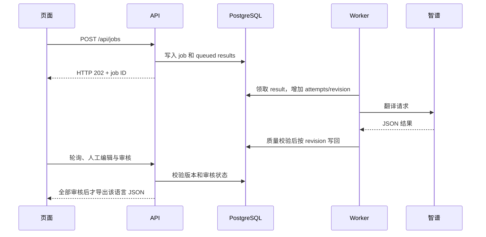

# 能力验收与实验手册

代码已生成和测试通过只说明这个项目可运行，不代表用户已经理解或具备独立实现能力。下面的操作和解释由学习者实际完成后，才能作为个人能力证据。

## 第一课：追一条翻译的完整路径

建议先用约 30 分钟完成这一课；这是练习安排，不是已学习时长。真实模型由 `.env` 的 `ZHIPU_MODEL` 决定；开始学习前先查看 `/api/health`，不要根据文档猜测当前模型。模型选择依据见 [模型记录](model-selection.md)。

1. 打开页面，输入 `{"lesson.hello":"Hello {name}!"}`，只选中文，创建任务。记录页面任务 ID；翻译完成后先不要审核，确认导出不可用。
2. 打开 `http://127.0.0.1:4310/api/docs`，用 `GET /api/jobs/{id}` 和 `GET /api/jobs/{id}/items` 查看刚才任务。观察 `status`、`attempts`、`revision`、`approved`。创建接口返回 HTTP 202 只说明任务已持久化；之后 worker 才调用模型。
3. 在页面把结果改为 `你好 {name}！`，审核并导出。再查 items，观察 revision 变化。试着删除 `{name}` 保存，确认后端拒绝不满足质量契约的内容。
4. 沿调用路径读代码：`web/api.ts` → `server/app.ts` → `Store.create` → `Worker.runOnce` → `ZhipuTranslator.translate` → `validateTranslation` → worker 的条件 UPDATE → `Store.export`。先读这一条路径，再研究错误分支和恢复。

完成标志：能用自己的话解释“为什么不在创建接口里一直等模型”“数据库保存了什么”“为什么模型结果晚到不能覆盖人工修改”。不要求第一次就记住全部 TypeScript 和 SQL 细节。

下面的 `transient`、`malformed`、`partial` 是 Fake 专用实验。学习这些错误路径时，将本地 `.env` 的 provider 改为 `fake` 并重启 API；真实模式不提供故障注入选项。实验后切回 `zhipu`，保留已有密钥和任务数据。

| 能力           | 可验证产物                            | 个人验收任务                                       |
| -------------- | ------------------------------------- | -------------------------------------------------- |
| React 异步交互 | 任务/结果独立轮询、mutation、冲突提示 | 解释为何不能由总状态控制所有轮询；复现一个过期编辑 |
| HTTP 服务契约  | TypeBox + OpenAPI + 前后端运行时检查  | 新增语言并让 schema、UI、样例同时通过              |
| SQL 与迁移     | 3 张业务表、唯一约束、迁移记录、事务  | 解释哪些约束由 DB 保证，哪些必须由服务保证         |
| 后台任务       | 持久化状态、单 worker 锁、启动恢复    | 中途重启服务，说明重复调用与 exactly-once 的区别   |
| AI 工程可靠性  | schema、key、语言、占位符、术语检查   | 设计一种 Fake 错误并证明它被拒绝或正确重试         |
| 人工协作       | revision 条件写回、人工保护、审核导出 | 翻译过程中人工修改，验证晚到结果被丢弃             |
| 质量评测       | 机械样例与语言评审分开                | 用真实模型完成盲评，报告失败样例与样本口径         |
| 验证与观察     | Vitest、API、Playwright、结构化日志   | 从一次失败定位到层次，补回归测试并解释证据边界     |

## 建议阅读与练习顺序

1. 先只读 SQL 和 API 契约，用 curl 创建一个任务，观察数据库记录。
2. 选 `transient`，核对 attempts 和尝试日志；选 `malformed`，确认输出错误不会直接入库。
3. 选 `partial`，法语失败且中文成功；编辑中文并审核，重试失败项，确认中文保持。
4. 删除翻译中的占位符尝试保存，应收到 `PLACEHOLDER_MISMATCH`；删除术语应收到 `TERM_MISMATCH`。
5. 对一个语言全部审核并导出；将下载 JSON 与逐项结果核对。
6. 使用 restart smoke 观察 running 记录恢复，解释为何数据库队列比内存队列可靠。
7. 已接入智谱官方 HTTP API；对真实模型结果做盲评，增加语义质量样例，并解释超时、退避和永久错误不重试的原因。

## 少量质量样例

`tests/fixtures/quality.json` 保存不涉及公司业务的英语源文、语言、占位符与术语样例。自动测试检查机械约束；接真实模型后，由人额外记录：语义是否准确、术语是否恰当、表达是否自然、是否符合 UI 长度。当前语义评审全部标为未验证。

不把 Fake 的 `[模拟/zh] English...` 当中文译文评分，不拿 HTTP 成功率代替翻译质量。

## 本次产出与尚未证明

已形成本地实现和可重复验证脚本。尚未证明：用户独立复现、解释设计权衡、独立定位故障、系统性真实模型质量、公开部署与外部用户反馈。学习时长未知，本次不填学习小时数。
